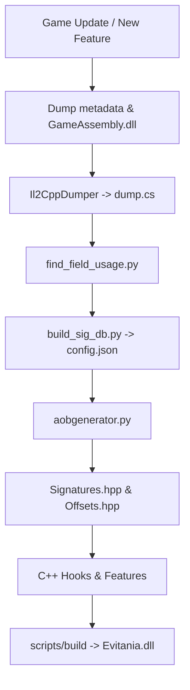

# Evitania Update & Reverse Engineering Workflow

## 1. Architecture & Pipeline Overview

Evitania is an internal C++20 mod for a Unity IL2CPP 64-bit Windows game running under Steam. Instead of relying on brittle static addresses or fragile runtime string lookups (`IL2CPP::Class::Utils::GetFieldOffset`), the project uses an automated 3-stage pipeline:



### Key Tool Roles
| Tool | Path | Role |
| :--- | :--- | :--- |
| **`Il2CppDumper`** | External tool | Generates `dump.cs` and `script.json` from `GameAssembly.dll` and `global-metadata.dat`. |
| **`find_field_usage.py`** | `resources/Tools/find_field_usage.py` | Disassembles methods to locate exact instruction and operand indices (`instr_idx`, `op_idx`) where fields are accessed. |
| **`build_sig_db.py`** | `resources/Tools/build_sig_db.py` | Scans `dump.cs` + `GameAssembly.dll` to generate unique AOB signatures and extraction rules into `config.json`. |
| **`aobgenerator.py`** | `resources/Tools/aobgenerator.py` | Pattern scans `GameAssembly.dll` against `config.json` and dynamically outputs `Signatures.hpp` and `Offsets.hpp`. |
| **`scripts/build`** | `scripts/build` | CMake + MinGW-w64 build runner producing `release/Evitania <version>.dll`. |
| **`scripts/run`** | `scripts/run` | Launches the game and handles DLL injection. |

---

## 2. Step-by-Step Update Procedure

When a game update drops on Steam:

### Step 2.1: Acquire New Dump
1. Locate the updated game files in Steam:
   - Linux: `~/.steam/steam/steamapps/common/Evitania Online/`
   - Windows: `C:\Program Files (x86)\Steam\steamapps\common\Evitania Online\`
2. Dump the assembly using `Il2CppDumper`:
   ```bash
   Il2CppDumper.exe GameAssembly.dll Evitania_Data/il2cpp_data/Metadata/global-metadata.dat <output_dir>
   ```
3. Copy the newly generated `dump.cs` to:
   ```bash
   resources/dumped/dump.cs
   ```
   *(Note: `GameAssembly.dll` is automatically discovered from your Steam library via AppID `4119420`, but you can also place a copy at `resources/dumped/GameAssembly.dll`).*

---

### Step 2.2: Discover & Inspect Field Usage
When hooking a new feature or if a field offset changed, use `find_field_usage.py` to inspect the assembly and verify extraction rules before adding them to the database.

**Commands**:
- **Inspect a specific field in a method**:
  ```bash
  python3 resources/Tools/find_field_usage.py Shop UpdateDiscount discount
  ```
- **Inspect compiler-generated backing fields**:
  ```bash
  python3 resources/Tools/find_field_usage.py ItemDetail get_Amount "<Amount>k__BackingField"
  ```
- **Disassemble method with visual instruction markers (`==> [MATCH]`)**:
  ```bash
  python3 resources/Tools/find_field_usage.py Shop UpdateDiscount discount --disasm
  ```
- **List all fields and their offsets for a class in `dump.cs`**:
  ```bash
  python3 resources/Tools/find_field_usage.py --list-fields Shop
  ```
- **List all methods and RVAs for a class in `dump.cs`**:
  ```bash
  python3 resources/Tools/find_field_usage.py --list-methods Shop
  ```
- **Audit all project extraction targets**:
  ```bash
  python3 resources/Tools/find_field_usage.py --all
  ```

`find_field_usage.py` outputs the exact target tuple and JSON snippet ready to copy into `build_sig_db.py`.

---

### Step 2.3: Update Baseline Signatures (`build_sig_db.py`)
Add any new or changed methods/fields to the `targets` list in [resources/Tools/build_sig_db.py](file:///home/riik/Projects/Evitania/resources/Tools/build_sig_db.py):

```python
# Format: (ClassName, MethodName, OverloadIndex, FieldsToExtract)
targets = [
    # Simple method signature without field extraction:
    ("Shop", "TryBuy", 0, []),

    # Method signature with field extraction:
    ("Shop", "UpdateDiscount", 0, [("discount", "Shop")]),

    # Method with renamed output field or backing field:
    ("ItemDetail", "get_Amount", 0, [("itemAmount", "<Amount>k__BackingField", "ItemDetail")]),
    ...
]
```

Then rebuild `config.json`:
```bash
python3 resources/Tools/build_sig_db.py
```

Ensure the output prints `[+] Added <MethodKey> to database` and concludes with:
`Database built successfully -> config.json`.

---

### Step 2.4: Regenerate C++ Headers (`aobgenerator.py`)
Run `aobgenerator.py` to scan `GameAssembly.dll` and generate the C++ headers:
```bash
python3 resources/Tools/aobgenerator.py
```

This updates:
1. `src/Modules/Hooks/Signatures.hpp` – Contains `constexpr const char*` byte patterns.
2. `src/Modules/Hooks/Offsets.hpp` – Contains centralized field offsets under `namespace Offsets`.

> [!IMPORTANT]
> **Check the output for warnings!**
> If an offset displays `(hardcoded fallback)`, verify whether the instruction layout changed in the new game binary. Use `find_field_usage.py <Class> <Method> <Field> --disasm` to check the new instruction index.

---

### Step 2.5: Adapt C++ Code & Hook Conventions
Follow these strict project conventions defined in `.agents/AGENTS.md`:

1. **Modular Architecture (1 Feature = 1 `.hpp`/`.cpp`)**:
   - Source code directory MUST match the ImGui tab 1:1 (`src/Features/<Domain>/`).
   - Every feature declares `void Initialize()` and `void Uninitialize()`, registered in `src/Modules/Hooks/Hooks.cpp`.
2. **Centralize Offsets**:
   - Never hardcode raw hex offsets (like `0x18`) in feature hooks or helpers.
   - Low-level IL2CPP structures live under `Offsets::Il2Cpp::...` (e.g. `Array::length`, `Dictionary::entries`).
   - Gameplay offsets live directly under `Offsets::...` (e.g. `Offsets::discount`, `Offsets::alive`).
3. **UI Visuals vs. Spending Validation (Dual-Mode Hooking)**:
   - For store/upgrade bypasses, game UI methods render currency icons by iterating dictionaries. If the count or item is empty, the UI icons disappear.
   - Game spend resolvers also block purchases if amount is $\le 0$.
   - **Pattern**: Use a `thread_local bool` flag during purchase execution to bypass checks, and use `Utils::Il2Cpp::ZeroDictionaryFloatValues` during UI rendering so icons remain visible with zero cost.
4. **Feature Isolation**:
   - Keep store purchase bypasses (`SteamPurchaseService` / `MobilePurchaseService`) strictly segregated from in-game skill progression (combat, woodcutting, mining talent points, or bonfire upgrades).
5. **Hot-Path Performance**:
   - Never allocate memory on the heap or perform expensive string searches inside getters or game loops.

---

### Step 2.6: Compile & Test
1. Build the release DLL:
   ```bash
   ./scripts/build release
   ```
   *(For debugging symbols and verbose logs: `./scripts/build debug`).*
2. Verify that the output DLL exists at `build/release/Evitania v0.320.1.dll`.
3. Test in-game:
   ```bash
   ./scripts/run
   ```

---

## 3. Quick Reference & Command Cheat Sheet

```bash
# 1. Inspect field usage / find instruction indices:
python3 resources/Tools/find_field_usage.py <Class> <Method> <Field> --disasm

# 2. Build baseline signature database:
python3 resources/Tools/build_sig_db.py

# 3. Generate Signatures.hpp and Offsets.hpp:
python3 resources/Tools/aobgenerator.py

# 4. Build DLL:
./scripts/build release

# 5. Launch game & inject:
./scripts/run
```
