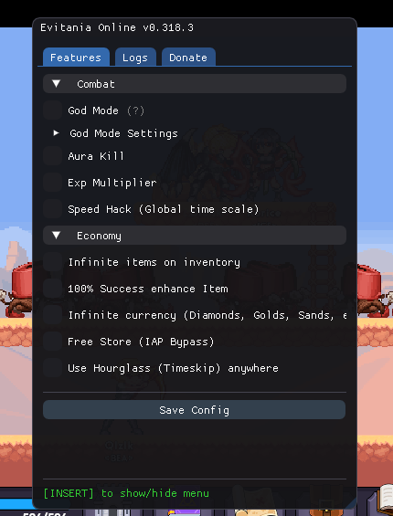

# Evitania Online


## Features

The architecture is strictly modularized into distinct feature categories located within the `src/Features/` directory.

<details>
<summary> Image Preview </summary>



</details>

## Build Instructions

### Prerequisites

| Requirement | Linux (Cross-Compile) | Windows (Native) |
| :--- | :--- | :--- |
| **CMake** | `>= 3.20` | `>= 3.20` |
| **Compiler** | MinGW-w64 (`x86_64-w64-mingw32-g++` C++20) | MSVC (Visual Studio 2019/2022/2026 C++20) or MinGW-w64 |
| **Python** *(Optional)* | Python 3 + `capstone` (for updating offsets) | Python 3 + `capstone` (for updating offsets) |

#### Installing Dependencies

- **Debian / Ubuntu**:
  ```bash
  sudo apt update && sudo apt install -y mingw-w64 cmake
  ```
- **Arch Linux**:
  ```bash
  sudo pacman -S mingw-w64-gcc cmake
  ```
- **Fedora**:
  ```bash
  sudo dnf install mingw64-gcc mingw64-gcc-c++ cmake
  ```
- **Windows**:
  - Install [CMake](https://cmake.org/download/) and ensure it is added to your system `PATH`.
  - Install **Visual Studio** (with the *Desktop development with C++* workload) or [MinGW-w64 (WinLibs / MSYS2)](https://winlibs.com/).

---

### Quick Build (Recommended)

```bash
git clone https://github.com/RiiK26/Evitania.git
cd Evitania
```

The repository provides a unified build script ([`scripts/build`](scripts/build)) that works seamlessly on both Linux and Windows.

#### Linux
```bash
./scripts/build
```

#### Windows
Run from Command Prompt (`cmd.exe`) or PowerShell:
```cmd
scripts\build
```

#### Build Flags
You can pass arguments to customize the build:

| Flag | Description |
| :--- | :--- |
| `clean` | Builds with debug symbols (`RelWithDebInfo`) and unstripped binaries for development/debugging. |
| `no-injector` | Skips building `injector.exe`, only compiling the mod DLL. |

**Examples:**
```bash
# Build with debug symbols and skip injector
./scripts/build clean no-injector

# Windows equivalent
scripts\build clean no-injector
```

---

### Manual CMake Build

If you prefer building manually without the wrapper script:

#### Linux (Cross-Compiling for Windows via MinGW)
```bash
mkdir -p build && cd build
cmake .. \
  -DCMAKE_SYSTEM_NAME=Windows \
  -DCMAKE_C_COMPILER=x86_64-w64-mingw32-gcc \
  -DCMAKE_CXX_COMPILER=x86_64-w64-mingw32-g++ \
  -DCMAKE_RC_COMPILER=x86_64-w64-mingw32-windres
cmake --build . -j$(nproc)
```

#### Windows (MSVC)
```cmd
mkdir build
cd build
cmake ..
cmake --build . --config Release -j %NUMBER_OF_PROCESSORS%
```

#### Windows (MinGW-w64)
```cmd
mkdir build
cd build
cmake -G "MinGW Makefiles" -DCMAKE_BUILD_TYPE=Release ..
cmake --build . -j %NUMBER_OF_PROCESSORS%
```

#### CMake Options Reference

| Option | Default | Description |
| :--- | :--- | :--- |
| `-DBUILD_CLEAN=ON\|OFF` | `OFF` | Build with symbols (`RelWithDebInfo`) instead of stripped `Release`. |
| `-DBUILD_INJECTOR=ON\|OFF` | `ON` | Build the standalone injector executable (`injector.exe`). |

---

### Output Binaries

All build targets are placed in the `build/release/` directory:
- `Evitania v<version>.dll` — The main mod library.
- `injector.exe` — Standalone DLL injector (if enabled).

---

### Running & Injection

1. **Linux (Steam Proton)**:
   Start the game through Steam, then run:
   ```bash
   ./scripts/run.sh
   ```
   *The script automatically detects the running game process and Proton environment.*

2. **Windows**:
   Run the launcher script:
   ```cmd
   scripts\run.bat
   ```
   *Or launch the game manually and run `injector.exe EvitaniaOnline.exe "build\release\Evitania v<version>.dll"`.*

3. **In-Game Overlay**:
   Press <kbd>INSERT</kbd> to toggle the ImGui menu. Configuration is automatically saved to `config.txt`.

---

### Updating Signatures & Offsets

When the game receives an update, update the offsets and signatures dynamically without full decompilation:

```bash
# Linux
./scripts/update_offsets.sh

# Windows
scripts\update_offsets.bat
```
*(Requires Python 3 and Capstone: `pip install capstone`)*

## Disclaimer

> I am not responsible for any actions taken by users of this cheat, including but not limited to violations of game terms of service or other regulations. Users should use this cheat at their own risk and be aware of the potential consequences.

## License
This project licensed under [MIT License](license).
