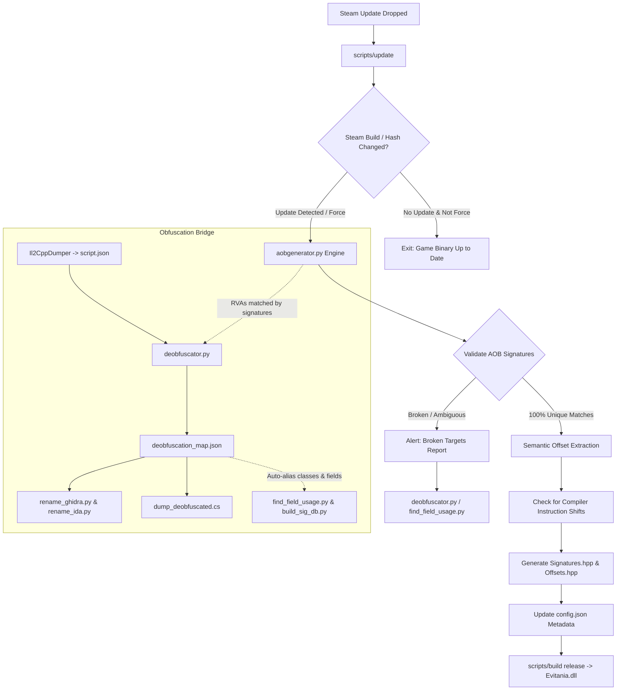

# Evitania Update & Reverse Engineering Engine

This directory contains the automated signature scanning, semantic offset extraction, and deobfuscation bridging toolchain for the Evitania project.

---

## 1. Architecture Overview

Evitania operates without relying on fragile static memory offsets or brittle runtime IL2CPP API calls (`IL2CPP::Class::Utils::GetFieldOffset`). Instead, it employs an automated 3-tier update pipeline:



---

## 2. Core Components & Tool Matrix

| Tool | Path | Primary Role |
| :--- | :--- | :--- |
| **Unified Runner** | [`scripts/update`](../../scripts/update) | **Primary Entry Point**: Detects Steam update, validates signatures, extracts semantic offsets, updates metadata, and rebuilds the DLL. |
| **Update Engine** | [`updater.py`](updater.py) | Python backend powering `scripts/update`. Inspects Steam `appmanifest_4119420.acf` and binary SHA-256 hash. Supports `--from-mem` and custom `--dll`. |
| **Memory Dumper** | [`dump_memory.py`](dump_memory.py) | Extracts decrypted `GameAssembly.dll` and `global-metadata.dat` from live process RAM (Linux/Wine/Proton and Windows). Rebuilds PE section headers. |
| **AOB & Offset Generator** | [`aobgenerator.py`](aobgenerator.py) | Scans raw machine code in `GameAssembly.dll` and extracts field offsets via two-pass semantic matching (strict + register-relaxed). |
| **Deobfuscator & Symbol Bridge** | [`deobfuscator.py`](deobfuscator.py) | Bridges obfuscated symbols to canonical project names using known AOB signatures as ground truth. |
| **Field Usage Inspector** | [`find_field_usage.py`](find_field_usage.py) | Developer inspection tool. Disassembles methods to locate field displacements and generates semantic assembly templates. |
| **Signature DB Builder** | [`build_sig_db.py`](build_sig_db.py) | Developer tool used when establishing new baseline signatures or adding new features from `dump.cs`. |

---

## 3. Step-by-Step Update Workflows

### Workflow A: Routine Game Update (Standard / 95% of Cases)

When the game updates on Steam, the internal offsets and memory locations shift, but the machine code instructions of methods rarely change significantly.

**Single Command Execution:**
```bash
# Linux
./scripts/update

# Windows
scripts\update.bat
```

**What Happens Behind the Scenes:**
1. **Steam Version Check**: Reads `steamapps/appmanifest_4119420.acf` for the current `buildid` and computes the SHA-256 hash of `GameAssembly.dll`.
2. **Signature Verification**: Pattern-scans all 100+ method signatures in `GameAssembly.dll`.
3. **Semantic Offset Extraction**: For each field rule in `config.json`, matches instructions using assembly patterns (e.g., `cmp byte ptr [rcx + ?], 0`). If the compiler inserted extra instructions before the field access, the engine dynamically locates the shifted instruction and extracts the correct displacement.
4. **Header Generation**: Regenerates `src/Modules/Hooks/Signatures.hpp` and `src/Modules/Hooks/Offsets.hpp`.
5. **Metadata Update**: Records the new `steam_build_id` and `assembly_sha256` in `config.json`.
6. **Automated Recompilation**: Invokes `scripts/build release` to produce a fresh `build/release/Evitania <version>.dll`.

---

### Workflow B: Obfuscated Game Update (Future-Proofing / Metadata Scrambling)

If a game update introduces rename obfuscation (where classes and methods become random strings like `Class_a19::Method_b72`), `dump.cs` and `script.json` become unreadable. However, **machine code remains machine code**, and your canonical AOB signatures hold the ground truth.

#### 1. Acquire Dump Files
Run `Il2CppDumper` on the updated files:
```bash
Il2CppDumper.exe GameAssembly.dll global-metadata.dat resources/dumped/
```
Ensure `resources/dumped/script.json` and `resources/dumped/dump.cs` exist.

#### 2. Run the Deobfuscator & Symbol Bridge
```bash
python3 resources/Tools/deobfuscator.py --all
```

**Outputs Produced:**
- **`resources/dumped/deobfuscation_map.json`**: JSON translation dictionary mapping obfuscated class/method/field names back to canonical project names.
- **`resources/dumped/dump_deobfuscated.cs`**: Cleaned C# dump where obfuscated classes and fields are replaced with canonical project names with original names annotated in comments.
- **`resources/dumped/rename_ghidra.py`**: Python script to import into Ghidra's Script Manager to auto-rename all functions and labels.
- **`resources/dumped/rename_ida.py`**: Python script for IDA Pro (`File -> Script file...`) to auto-rename subroutines.

#### 3. Automatic Alias Inheritance
Once `deobfuscation_map.json` exists, both `find_field_usage.py` and `build_sig_db.py` automatically load it. You can query canonical names as usual:
```bash
python3 resources/Tools/find_field_usage.py EnemyNpcController TakeDamage alive
```
The tools will automatically map `EnemyNpcController` to `Class_a19` and `alive` to `field_xyz`.

---

### Workflow C: Hooking a New Feature / Adding New Offsets

When writing a brand new feature that requires a new method hook or field offset:

#### 1. Inspect Field Usage & Disassemble
```bash
# View instruction operands and get suggested JSON rules:
python3 resources/Tools/find_field_usage.py Shop UpdateDiscount discount

# Disassemble the method with visual marker [MATCH]:
python3 resources/Tools/find_field_usage.py Shop UpdateDiscount discount --disasm
```

#### 2. Add Target to `build_sig_db.py`
Edit `targets` in `resources/Tools/build_sig_db.py`:
```python
targets = [
    # Format: (ClassName, MethodName, OverloadIdx, [(OutputName, FieldName, FieldClass)])
    ("Shop", "UpdateDiscount", 0, [("discount", "Shop")]),
]
```

#### 3. Rebuild Database & Headers
```bash
python3 resources/Tools/build_sig_db.py
./scripts/update --force
```

---

### Workflow D: Handling Encrypted Binaries & Missing Dumps (Live Memory Bridge)

If the game updates with binary packing/encryption (e.g. Themida, VMProtect, Steam DRM stub) or if metadata is encrypted/stripped so `dump.cs` cannot be generated:

1. **Launch the Game**: Run `Evitania.exe` through Steam. The game's native loader will unpack the code and decrypt IL2CPP metadata into RAM.
2. **Execute In-Memory Extraction**:
   ```bash
   # Automatically dumps GameAssembly.dll from RAM and runs the full update pipeline:
   scripts/update --from-mem

   # Or run the dumper manually:
   python3 resources/Tools/dump_memory.py
   scripts/update --dll resources/dumped/GameAssembly_memory.dll
   ```

**What the Dumper Does:**
- Introspects the running game process (Linux `/proc/<pid>/mem` or Windows `ReadProcessMemory`).
- Dumps the fully decrypted `GameAssembly.dll` from RAM to `resources/dumped/GameAssembly_memory.dll`.
- Reconstructs PE Section Headers (`PointerToRawData = VirtualAddress`), making the dump 100% valid for Capstone and Ghidra.
- Scans process memory for the `0xFAB11BAF` magic to dump unencrypted `global-metadata_dumped.dat`.

---

## 4. Semantic Offset Extraction Rules

In `config.json`, extraction rules support human-readable assembly templates with `?` as the displacement placeholder:

```json
"EnemyNpcController_TakeDamage": {
    "signature": "40 53 48 83 EC 20 80 79 3C 00 48 8B D9 74 4C ...",
    "extract": {
        "alive": {
            "pattern": "cmp byte ptr [rcx + ?], 0",
            "instr_idx": 2,
            "op_idx": 0
        }
    }
}
```

### Two-Pass Semantic Engine:
- **Pass 1 (Strict)**: Matches exact register names specified in `pattern` (e.g. `rcx`, `rdi`).
- **Pass 2 (Relaxed-Register)**: If the compiler swapped registers (e.g. `rcx` -> `rax`, `rdi` -> `rbx`, `xmm6` -> `xmm1`), automatically relaxes register constraints while preserving mnemonic, operands, and memory displacement structures. This prevents updates from breaking on compiler optimization shifts.

### Rule Properties:
| Property | Type | Description |
| :--- | :--- | :--- |
| `pattern` | `string` | Assembly template with `?` matching the displacement. Example: `"movss dword ptr [rcx + ?], xmm6"`. Supports wildcard registers using `*`. |
| `instr_idx` | `int` | Fallback and proximity anchor index. If multiple instructions match the pattern, the engine selects the candidate closest to `instr_idx`. |
| `op_idx` | `int` | Preferred operand index (0 for destination, 1 for source). |
| `match_idx` | `int` | *(Optional)* Explicit match occurrence (0 for first occurrence, 1 for second). |
| `hardcoded` | `int` | Static offset fallback for generic collections (`Il2Cpp_Array`, `Il2Cpp_Dictionary`, `Il2Cpp_List`). |

---

## 5. Command-Line Reference

### `scripts/update` (and `updater.py`)
```bash
# Standard automated update (runs only if Steam build changed)
./scripts/update

# Check update status without building:
./scripts/update --check

# Force scan and rebuild even if build ID is unchanged:
./scripts/update --force

# Update headers without invoking CMake compilation:
./scripts/update --no-build

# Build in Debug mode:
./scripts/update --force --build-type debug

# Generate JSON summary report (update_report.json):
./scripts/update --force --report

# Extract from live game RAM when disk binary is encrypted:
./scripts/update --from-mem

# Extract from a custom dumped binary:
./scripts/update --dll resources/dumped/GameAssembly_memory.dll
```

### `dump_memory.py`
```bash
# Auto-detect running Evitania process, dump GameAssembly.dll and global-metadata.dat:
python3 resources/Tools/dump_memory.py

# Attach to a specific PID:
python3 resources/Tools/dump_memory.py --pid 12345

# Target a custom process name or output folder:
python3 resources/Tools/dump_memory.py --name Evitania.exe --output-dir resources/dumped
```

### `deobfuscator.py`
```bash
# Run full bridge (generates map, Ghidra script, IDA script, and deobfuscated dump):
python3 resources/Tools/deobfuscator.py --all

# Generate only Ghidra rename script:
python3 resources/Tools/deobfuscator.py --ghidra

# Generate only IDA Pro rename script:
python3 resources/Tools/deobfuscator.py --ida

# Generate only clean C# dump:
python3 resources/Tools/deobfuscator.py --patch-dump
```

### `find_field_usage.py`
```bash
# Inspect specific field in method:
python3 resources/Tools/find_field_usage.py <Class> <Method> <Field>

# Disassemble with instruction match markers:
python3 resources/Tools/find_field_usage.py <Class> <Method> <Field> --disasm

# Audit all project extraction targets:
python3 resources/Tools/find_field_usage.py --all

# List fields for a class:
python3 resources/Tools/find_field_usage.py --list-fields <Class>

# List methods for a class:
python3 resources/Tools/find_field_usage.py --list-methods <Class>
```

---

## 6. Troubleshooting & Diagnostics

- **`[!] UPDATE AVAILABLE`**: Steam downloaded a new game binary. Run `./scripts/update` to re-align signatures and recompile.
- **`semantic shift (idx A -> B)`**: The compiler inserted or removed instructions before the field. The semantic pattern engine automatically resolved the shift; no manual action required.
- **`Broken Signature (0 matches)`**: The game updated the code of that specific method. Use `find_field_usage.py` or inspect in Ghidra using `resources/dumped/rename_ghidra.py` to identify the new pattern, then update `config.json`.
- **`Ambiguous Signature (>1 matches)`**: The signature is too short. Extend the hex bytes in `config.json` by 4–8 bytes until unique.
